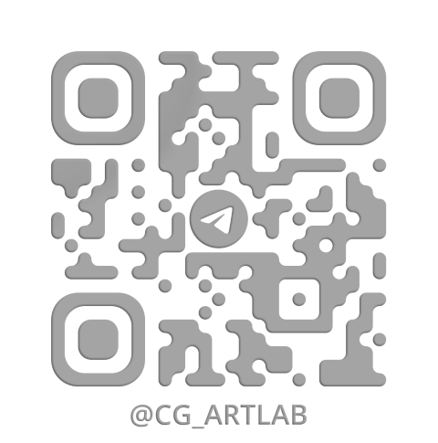

## About 

I'm a [Motion visual designer](https://cgartlab.com/works), [Content creator](https://cgartlab.com/), [Product engineer](https://github.com/cgartlab) from China.

I explore the intersection of Design, AI, Knowledge Management, and Automation, building tools and workflows that help creators work more efficiently.

Currently focusing on **RSS automation**, **AI-assisted content pipelines**, and **design systems** that bridge creative and engineering work.

### Featured Projects / 精选项目

- **[cgartlab.github.io](https://github.com/cgartlab/cgartlab.github.io)** — Personal site & portfolio built with Astro.
- **[edic-design-system](https://github.com/cgartlab/edic-design-system)** — Reusable design system for consistent visual language.
- **[rss-updater](https://github.com/cgartlab/cgartlab)** — This repo: automated blog-post sync into README via RSS + CI.

<!-- BLOG_POSTS_START -->
## 📝 Latest Blog Posts / 最新博客文章

*Last Updated: 2026-10-18 10:11:02 UTC*

- [阅读，思考，写作，哪个更重要？\-No\.24](https://cgartlab.com/posts/weekly-24/) — 2026-10-13
- [设计中的通杀概念 \- No\.23](https://cgartlab.com/posts/weekly-23/) — 2026-10-07
- [人人可用的互联网基础设施 \- No\.22](https://cgartlab.com/posts/weekly-22/) — 2026-10-03
- [为什么没感觉到 AI 让你变快？\- No\.21](https://cgartlab.com/posts/weekly-21/) — 2026-09-27
- [文字内容创作的形式 \- No\.20](https://cgartlab.com/posts/weekly-20/) — 2026-09-11
<!-- BLOG_POSTS_END -->

## Contact

  
  &nbsp;&nbsp;&nbsp;
  

WeChat: cgartlab-com | Telegram: [@cgartlab](https://t.me/cgartlab)

## Status / 项目状态

  
  
  

  
  
  
  
  

  
  
  
  

